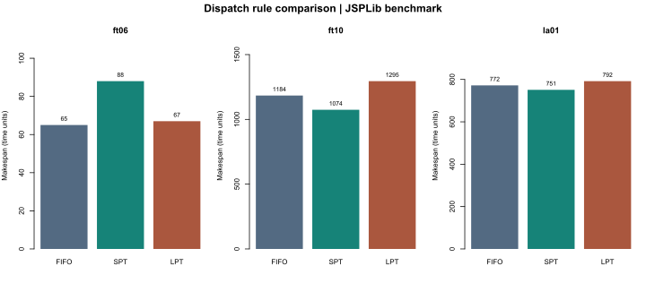

# 生產排程與產能利用率分析

**Production Scheduling & Capacity Utilization Analytics**

面向工業工程、生產規劃與製造分析的作品。以 ScheduleOpt JSPLib 公開 Job Shop 基準比較同一批工序在 FIFO、SPT、LPT 下的完工跨度與機台空檔。時間以基準「時間單位」表示。所有情境為模擬。

## 執行結果

| 案例 | 工件 × 機台 | 工序 | FIFO | SPT | LPT | SPT 相對 FIFO |
|---|---:|---:|---:|---:|---:|---:|
| ft06 | 6 × 6 | 36 | 65 | 88 | 67 | −35.38% |
| ft10 | 10 × 10 | 100 | 1,184 | 1,074 | 1,295 | +9.29% |
| la01 | 10 × 5 | 50 | 772 | 751 | 792 | +2.72% |

ft10 的 SPT 在三個規則中完工跨度最短，平均機台利用率由 43.15% 升到 47.57%，總機台閒置由 6,731 降到 5,631。機台加工量固定，利用率差異來自完工跨度縮短。ft06 的排序反轉說明派工效果需要按案例驗證。



## 在 Windows 啟動 Dashboard

在 RStudio 將工作目錄切換至本專案根目錄，執行：

```r
install.packages(c("shiny", "plotly"), repos = "https://cloud.r-project.org")
shiny::runApp("app", launch.browser = TRUE)
```

已有套件時可直接執行第二行。總覽上方切換案例與規則，甘特圖可依工件或機台過濾，規則比較頁始終顯示同案例三規則。展示版讀取隨附的 PostgreSQL 匯出結果，啟動只需要 R 與 Shiny 相依套件。

## 從上游資料重建

本次在 Windows 驗證 R 4.5.2 與 PostgreSQL 17.11。缺少工具時可先使用官方 Windows 安裝程式。DBeaver Community 可用來查看資料及逐題操作 SQL。[R](https://cran.r-project.org/bin/windows/base/) · [RStudio](https://posit.co/download/rstudio-desktop/) · [PostgreSQL](https://www.postgresql.org/download/windows/) · [DBeaver](https://dbeaver.io/download/)

1. 在 PostgreSQL 安裝程式完成本機服務設定並記下連接埠。以 pgAdmin 或 DBeaver 連到現有的 `postgres` 資料庫，執行一次 `CREATE DATABASE portfolio;`。執行管線的帳號需能在該庫建立 schema。
2. 在 RStudio 根目錄執行 `install.packages(c("jsonlite", "digest"))`。若要重抓原始資料，在 PowerShell 執行 `& $r R/download.R`。版本與 SHA-256 由 `data/raw/sources.csv` 固定。
3. 在同一個 PowerShell 工作階段執行以下命令，依實際安裝路徑與使用者調整。psql 可直接在終端提示輸入密碼，也可使用本機 `%APPDATA%\postgresql\pgpass.conf`。

```powershell
$r = "C:/Program Files/R/R-4.5.2/bin/Rscript.exe"
$psql = "C:/Program Files/PostgreSQL/17/bin/psql.exe"
$env:LC_ALL = ".UTF-8"
$env:PGHOST = "127.0.0.1"
$env:PGPORT = "5432"
$env:PGDATABASE = "portfolio"
$env:PGUSER = "postgres"

& $r R/prepare.R
if ($LASTEXITCODE) { throw "R preparation failed" }
./run-sql.ps1 -Psql $psql
& $r R/check_exports.R
if ($LASTEXITCODE) { throw "Cross-check failed" }
& $r R/plot_results.R
& $r R/publish_data.R
& $r R/check_app.R
```

新資料庫可先用 `R/prepare.R ft06` 單跑小案例。全部案例請執行不帶參數的版本。匯入以案例為單位交易替換，品質檢查失敗時該批回滾。公開更新順序為 R 生成、SQL 匯入與匯出、R 交叉核對、更新 `app/data/` 後重新部署。

## 專案結構

| 目錄 | 內容 |
|---|---|
| `data/raw/` | 原始 JSON、固定版本、下載日及雜湊 |
| `data/processed/` | 可重建的 PostgreSQL 匯入 CSV |
| `R/` | 下載、正規化、事件派工、驗證與展示資料同步 |
| `sql/` | Schema、VIEW、品質檢查、12 項分析、匯入與匯出 |
| `outputs/` | PostgreSQL 結果 CSV 與 R 產出的比較圖 |
| `app/` | Shiny、樣式與展示快照 |
| `docs/` | [ERD](docs/erd.md)、[SQL 導讀](docs/sql-guide.md)、[方法與來源](docs/method.md)、[部署](docs/deploy.md)、[面試稿](docs/interview.md) |

公開 Dashboard 與遠端 GitHub 專案連結待建立與實測後填入。
