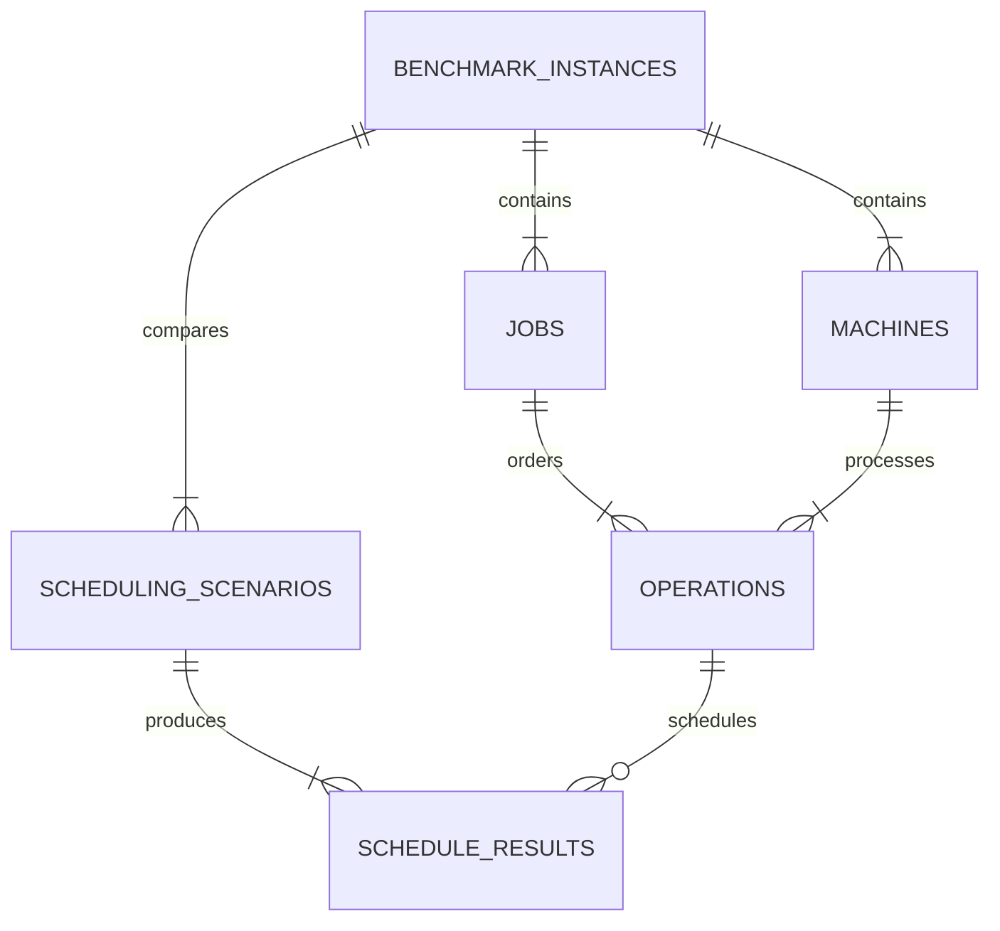

# ERD 與資料字典

| 表 | 主鍵 | 其他欄位 |
|---|---|---|
| benchmark_instances | instance_id | source_url、source_commit、downloaded_on、sha256、expected_jobs、expected_machines、expected_operations、precedence_count |
| jobs | instance_id、job_id | job_id 保留上游編號 |
| machines | instance_id、machine_id | machine_id 保留上游編號 |
| operations | instance_id、operation_id | job_id、machine_id、step 皆保留上游編號，duration 為正整數時間單位。案例內 job_id＋step 唯一 |
| scheduling_scenarios | instance_id、rule | policy_version 為派工實作版本 |
| schedule_results | instance_id、rule、operation_id | start_time、end_time。機台由 operations 取得，避免重複儲存 |

所有跨表工件、機台、工序與情境關係都以 instance_id 作為複合外鍵的一部分。原始有向邊保留於 JSON，匯入前逐一比對同工件的相鄰 step。
