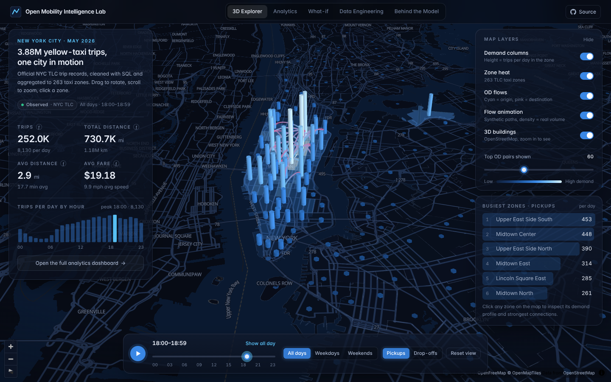
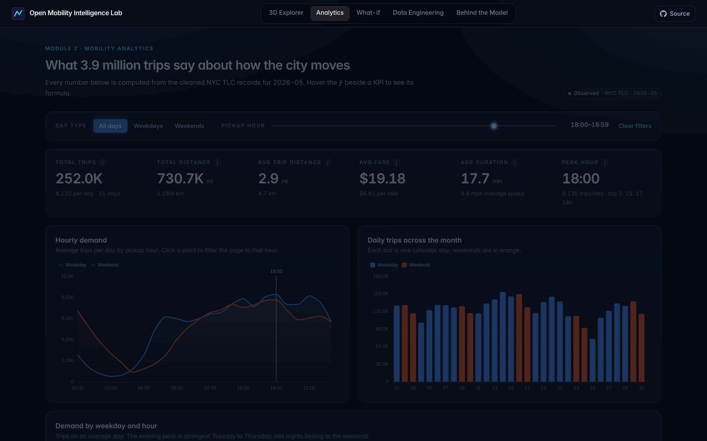

# Open Mobility Intelligence Lab

**Open Data Driven 3D Mobility Analytics & Decision Intelligence Platform**

以紐約市 TLC 官方公開的 Yellow Taxi 行程紀錄為資料，從原始 Parquet 檔一路做到可在瀏覽器操作的 3D 運輸分析與情境模擬平台。純靜態網站，無帳號、無後端、無付費服務。



| | |
|---|---|
| 資料 | NYC TLC Yellow Taxi Trip Records，2026 年 5 月，4,090,836 筆原始行程 |
| 清理後 | 3,875,963 筆（保留 94.75%），11 條規則逐條記錄排除筆數 |
| 驗證 | 18 項資料對帳檢查、41 個前端單元測試、38 個管線單元測試，全數通過 |
| 管線耗時 | 約 3 秒（DuckDB，4 核心 Linux 容器） |
| 瀏覽器載入 | 5 個預先聚合的 JSON，約 1 MB，瀏覽器不接觸任何原始行程 |
| 成本 | NT$0 |

## 五個模組

1. **3D Mobility Explorer**：MapLibre 底圖與 3D 建築，deck.gl 繪製 263 個計程車區的需求柱、區域熱度、OD 弧線與流向動畫；24 小時時間軸可播放，點選區域可看需求曲線與主要往來區域。
2. **Mobility Analytics Dashboard**：總行程、總里程、平均里程、平均車資、平均時間、尖峰時段、每小時需求、每日趨勢、星期 × 小時熱圖、上下車熱區、里程分布、OD 流向。每個 KPI 旁的 ƒ 可查看公式。
3. **What-if Simulation**：以觀測里程為基礎，調整空車比例、里程改善比例、車輛燃油效率，輸出基準與情境排放、絕對與百分比減量、龍捲風圖與雙因子敏感度。
4. **Data Engineering & Validation**：管線步驟、原始與清理後筆數、缺失值、離群值、驗證結果、處理時間，以及實際執行的 SQL。
5. **Behind the Model**：資料來源與授權、資料分類、公式、架構、測試結果、限制與重現步驟。



## 資料真實性分類

平台上每個數字都屬於下列四類之一，介面以標籤標示。

| 類別 | 定義 | 例子 |
|---|---|---|
| Observed | 直接由官方行程紀錄計數或加總 | 行程數、總里程、各區上下車數、OD 配對量 |
| Derived | 由觀測值或官方圖資計算 | 平均值、每日行程、平均速度、尖峰時段、簡化後的區域多邊形 |
| Synthetic | 為視覺化而產生，不是量測 | 流向動畫的粒子與弧線形狀 |
| Estimated | 依可調假設計算的模型輸出 | What-if 模組的所有 CO₂ 數字 |

TLC 只公布上下車「區域」，沒有 GPS 軌跡。地圖上的流向動畫是在區域標記點之間畫出的示意路徑，粒子數量與真實 OD 量成正比，路徑本身不代表實際行駛路線。本專案未使用任何論文、企業或私人資料。

## 資料來源與授權

| 資料 | 來源 | 說明 |
|---|---|---|
| Yellow Taxi Trip Records（2026-05） | [NYC TLC Trip Record Data](https://www.nyc.gov/site/tlc/about/tlc-trip-record-data.page) | 紐約市政府公開資料。TLC 聲明資料由車載設備廠商回報，不保證正確性 |
| Taxi Zone Lookup、Taxi Zone Shapefile | 同上 | 263 區，EPSG:2263 |
| 底圖與 3D 建築 | [OpenFreeMap](https://openfreemap.org)（OpenMapTiles schema） | 地圖資料 © [OpenStreetMap](https://www.openstreetmap.org/copyright) contributors，ODbL；免金鑰公開圖磚，地圖上顯示姓名標示 |
| 排放係數 | [U.S. EPA: Greenhouse Gas Emissions from a Typical Passenger Vehicle](https://www.epa.gov/greenvehicles/greenhouse-gas-emissions-typical-passenger-vehicle) | 每加侖汽油 8,887 g CO₂；典型乘用車 22.2 mpg，約 400 g CO₂/mile |

三個來源檔的大小與 SHA-256 由 `pipeline/download.py` 記錄，並顯示在 Data Engineering 頁面。

> 待確認：開發環境無法連線 nyc.gov，TLC 資料頁的使用條款文字未能逐字核對。公開展示前建議親自開啟上方 TLC 頁面確認條款。

## 系統架構

```
NYC TLC 公開檔案 ──► 離線管線 (Python + DuckDB SQL + GeoPandas) ──► 靜態 JSON ──► 瀏覽器 (React + MapLibre + deck.gl + ECharts)
   Parquet / CSV / SHP        清理 · 聚合 · 18 項驗證              約 1 MB           GitHub Pages
```

```
open-mobility-intelligence-lab/
├── pipeline/                 資料工程
│   ├── config.py             月份、來源網址、清理門檻
│   ├── download.py           下載官方檔案並記錄 SHA-256
│   ├── run_pipeline.py       執行 SQL、驗證、輸出 JSON
│   ├── zones.py              區域圖資：轉換座標、簡化、接合 lookup
│   ├── sql/                  01_profile · 02_clean · 03_aggregate · 04_quality
│   └── tests/                pytest：清理規則與輸出一致性
├── web/                      前端
│   ├── public/data/          管線輸出（已提交，網站直接使用）
│   └── src/
│       ├── lib/              selectors（KPI）、emissions（模型）、flows（動畫）及其測試
│       ├── components/       圖表、UI 元件
│       └── modules/          五個模組頁面
└── docs/                     方法說明、面試展示指引
```

技術選型的理由：

- **DuckDB**：單機直接查詢 Parquet，400 萬筆的清理與聚合不到 2 秒，SQL 檔可獨立閱讀。
- **預先聚合**：KPI 以「日型態 × 小時」的可加總立方體輸出，前端任意篩選都是加總後相除，不會出現平均值的平均。OD 的「全部日」「全部小時」用 `GROUPING SETS` 在 SQL 精確計算，不在前端加總被截斷的 top-N。
- **MapLibre + deck.gl**：開源、免金鑰，WebGL 繪製。
- **靜態部署**：沒有伺服器就沒有費用與維運。

## 重現分析

需要 Python 3.11+ 與 Node 20+。

```bash
cd open-mobility-intelligence-lab
python -m venv .venv && source .venv/bin/activate
pip install -r pipeline/requirements.txt
python pipeline/download.py          # 下載官方檔案（約 71 MB）
python pipeline/run_pipeline.py      # 清理、聚合、驗證、輸出 web/public/data
python -m pytest pipeline/tests

cd web
npm ci
npm test                             # 前端單元測試
npm run dev                          # http://localhost:5173
npm run build                        # 輸出 web/dist
npm run test:report                  # 更新 Behind the Model 頁面的測試結果
```

要換月份，修改 `pipeline/config.py` 的 `MONTH`、`MONTH_START`、`MONTH_END` 後重跑管線。

## 部署到 GitHub Pages

`.github/workflows/mobility-lab.yml` 會在推送到 `main` 時執行測試、建置並部署。第一次需要手動開啟：

1. 將本分支合併到 `main`。
2. GitHub repo → Settings → Pages → Source 選 **GitHub Actions**。
3. 到 Actions 頁面確認 workflow 成功，網址為 `https://jinhuixin000.github.io/production-scheduling-analytics/`。

建置使用相對路徑，也可以直接把 `web/dist` 放到 Cloudflare Pages。

## 測試

| 範圍 | 工具 | 數量 | 內容 |
|---|---|---|---|
| 資料對帳 | 管線內建 | 18 | 筆數守恆、各聚合表與清理表對帳、參照完整性、DuckDB 與 NumPy 獨立重算比對 |
| 管線 | pytest | 38 | 每條清理規則、邊界值、規則優先順序、聚合與 rollup、輸出檔一致性 |
| 前端 | Vitest | 41 | KPI selectors、排放模型（含手算對照與輸入驗證）、流向粒子、已發布資料檔互相對帳 |

另以 headless Chromium 對正式建置逐頁截圖，並實測區域點選、tooltip、時間軸播放與篩選，無 console 錯誤。

## 已知限制

- 只有一個月、只有 Yellow Taxi；不含 Green Taxi 與網約車。
- 位置是區域而非地址，真實路線未知。
- 平日定義為週一至週五，5 月 25 日 Memorial Day 算作平日。
- 平均車資為跳表車資，不含小費、過路費與附加費。
- 排放為情境估算：單一車隊平均係數、空車比例為假設值、只計算排氣管 CO₂。不能當作紐約計程車隊的排放盤查。
- 底圖由 OpenFreeMap 即時載入；該服務無法連線時，資料圖層仍會顯示在純色背景上。
- 動畫流暢度尚未在實體 GPU 上量測；開發環境只有軟體 WebGL。

## 參考作品

開發前研究了四個參考專案，只吸收設計概念，沒有使用其程式碼或素材。

| 專案 | 確認結果 | 採用的概念 |
|---|---|---|
| [3D City With a Million Moving Cars](https://github.com/webtrackerxy/3d-city-million-cars) | GitHub 頁面可讀取。Three.js 自訂圖層 + MapLibre、GPU instancing、OpenFreeMap 底圖 | MapLibre 搭配 OSM 3D 建築、OpenFreeMap 免金鑰底圖 |
| [NYC Taxi Analytics Dashboard](https://github.com/amirrezaskh/NYC-taxi-dashboard) | GitHub 頁面可讀取。React + MUI + Plotly + Leaflet，資料來自 BigQuery | 區域熱度、指標切換、OD 流向 |
| NYC Yellow Cab Trips（poopdeck.gl） | 開發環境的網路政策無法連線，未能確認 | 依描述採用時間軸播放與流向動畫的概念 |
| TrafficTwin Jeddah | 開發環境的網路政策無法連線，未能確認 | 依描述採用情境比較與決策支援的概念 |

## 授權

程式碼以 MIT 授權釋出。資料與圖資的授權見上方「資料來源與授權」。

更多內容：[方法說明](docs/methodology.md) · [面試展示指引](docs/interview-guide.md)
